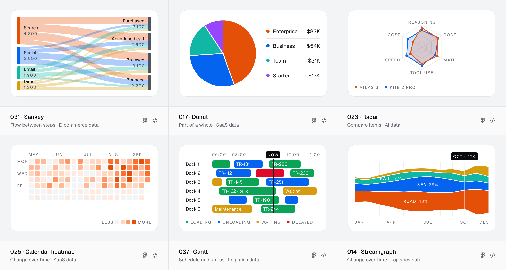
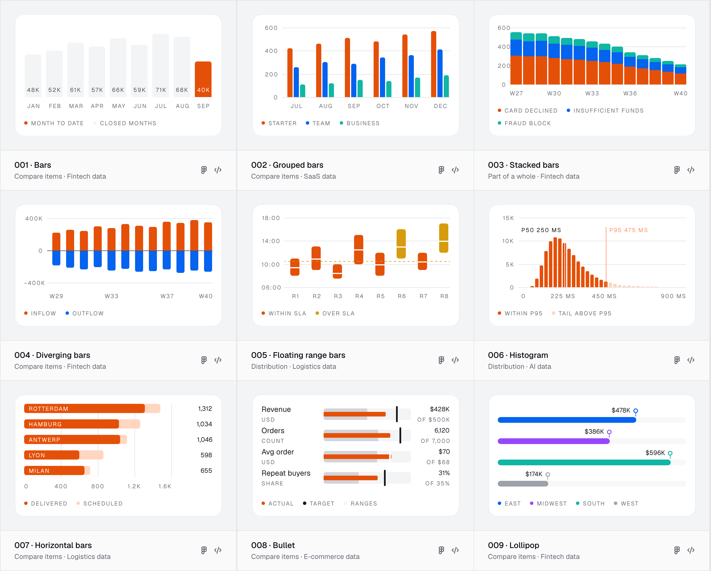

<!-- Generated by scripts/registry/public-repo.mjs in the Chartory site repository. Edit the template there. -->
<p align="center">
  <a href="https://usechartory.com">
    <picture>
      <source media="(prefers-color-scheme: dark)" srcset=".github/assets/lockup-dark.svg">
      
    </picture>
  </a>
</p>

<h1 align="center">100 chart types for React. Free.</h1>

<p align="center">
  Real charts with real layouts: sankeys, gantts, calendar heatmaps, ridgelines, marimekkos and 95 more.<br>
  Install one with the shadcn CLI. Own the code. No chart library underneath.
</p>

<p align="center">
  <a href="https://usechartory.com/free"><strong>Browse the charts</strong></a> ·
  <a href="https://usechartory.com/docs/installation">Docs</a> ·
  <a href="https://usechartory.com/docs/agents">MCP server</a> ·
  <a href="https://usechartory.com/pricing">Pricing</a>
</p>

<p align="center">
  <a href="https://ui.shadcn.com/docs/directory"></a>
  
  
  
</p>

<picture>
  <source media="(prefers-color-scheme: dark)" srcset=".github/assets/showcase-dark.png">
  
</picture>

```bash
npx shadcn@latest add @chartory/sankey
```

```tsx
import { Sankey } from "@/components/chartory/sankey"

export function Traffic() {
  return <Sankey size="m" />
}
```

That is the whole setup: the chart, its engine and its tokens land in your project as plain TypeScript.

## Why Chartory

Most chart libraries give you a canvas and a config object. Chartory gives you the finished chart, and each chart is
drawn for the question it answers.

- **Laid out from your data.** Every chart is laid out again for the data you pass and the size you pick, so labels
  fit, ticks round, and long names wrap or stack. Nothing overlaps, at any of the four sizes.
- **Four sizes, one prop.** `size="xs" | "s" | "m" | "l"`, with the legend on or off. No resize observers, no
  hand-tuned margins.
- **The code is yours.** It installs as source, not as a package. Read it, change it, keep it.
- **React and nothing else.** The engine draws SVG: no D3, no Recharts, no canvas, no runtime dependencies besides
  React. Charts render on the server and play in on the client.
- **Motion that means something.** Charts draw in when they come into view and morph to new data (`states`), or tick
  through it live (`interval`). Reduced motion is respected.
- **Light and dark.** Hearth tokens for light and dark (`.dark` or `data-theme`), and four chart colours
  (`color="cat-1"` … `"cat-4"`), or the colour set around the chart.
- **Accessible by default.** Every chart carries a text summary and a data table for screen readers. Pass your own with
  `describe`, or mark an illustration `decorative`.
- **Made for agents.** Each chart has one slug, the same in the URL, the registry and Figma, and the
  [Chartory MCP server](https://usechartory.com/docs/agents) lets Claude, Cursor and other agents find, install and
  configure charts for you.

## Install

Chartory installs with the [shadcn CLI](https://ui.shadcn.com/docs/cli) into any React project that has a
`components.json` (Next.js, Vite and the rest).

1. Add a chart by its slug:

   ```bash
   npx shadcn@latest add @chartory/waterfall
   ```

   `@chartory` is in the [shadcn registry directory](https://ui.shadcn.com/docs/directory), so the CLI finds it. If
   your CLI asks where `@chartory` lives, add it to `components.json`:

   ```json
   {
     "registries": {
       "@chartory": "https://usechartory.com/r/{name}.json"
     }
   }
   ```

2. Import the tokens once in your global CSS. `chartory.css` lands at the project root; from `src/app/globals.css`:

   ```css
   @import "../../chartory.css";
   ```

3. Render it:

   ```tsx
   import { Waterfall } from "@/components/chartory/waterfall"

   <Waterfall size="l" legend />
   ```

Add several at once; shared parts install once:

```bash
npx shadcn@latest add @chartory/bars @chartory/donut @chartory/gantt
```

Run the same command with `--overwrite` to update a chart to its newest version.

## Your data

Each chart ships with realistic sample data, so it looks right the moment it lands. Pass your own in the same shape:

```tsx
import { Bars, type BarsData } from "@/components/chartory/bars"

const spend: BarsData = { /* the same shape as the sample in lib/chartory/charts/types/001-bars/data.ts */ }

<Bars data={spend} size="m" />
```

Every type's data shape, props and edge cases are on its docs page, for example
[usechartory.com/docs/charts/bars](https://usechartory.com/docs/charts/bars).

<picture>
  <source media="(prefers-color-scheme: dark)" srcset=".github/assets/free-dark.png">
  
</picture>

## The 100 free charts

Grouped by the question they answer. Each name links to its page, with all four sizes and its docs.

**Change over time** (17)<br>
[010 Line](https://usechartory.com/charts/line) · [011 Area](https://usechartory.com/charts/area) · [012 Multi-line](https://usechartory.com/charts/multi-line) · [013 Overlapping areas](https://usechartory.com/charts/overlapping-areas) · [014 Streamgraph](https://usechartory.com/charts/streamgraph) · [015 Forecast band](https://usechartory.com/charts/forecast-band) · [025 Calendar heatmap](https://usechartory.com/charts/calendar-heatmap) · [026 Cohort](https://usechartory.com/charts/cohort) · [036 Candlestick](https://usechartory.com/charts/candlestick) · [046 Bar and line combo](https://usechartory.com/charts/bar-and-line-combo) · [051 Spiral year](https://usechartory.com/charts/spiral-year) · [054 Horizon](https://usechartory.com/charts/horizon) · [056 Renko](https://usechartory.com/charts/renko) · [080 Underwater drawdown](https://usechartory.com/charts/underwater-drawdown) · [084 Stock sawtooth](https://usechartory.com/charts/stock-sawtooth) · [090 Funding stripes](https://usechartory.com/charts/funding-stripes) · [094 Radial lollipop](https://usechartory.com/charts/radial-lollipop)

**Compare items** (14)<br>
[001 Bars](https://usechartory.com/charts/bars) · [002 Grouped bars](https://usechartory.com/charts/grouped-bars) · [004 Diverging bars](https://usechartory.com/charts/diverging-bars) · [007 Horizontal bars](https://usechartory.com/charts/horizontal-bars) · [008 Bullet](https://usechartory.com/charts/bullet) · [009 Lollipop](https://usechartory.com/charts/lollipop) · [021 Gauge](https://usechartory.com/charts/gauge) · [023 Radar](https://usechartory.com/charts/radar) · [044 Slope](https://usechartory.com/charts/slope) · [045 Bump](https://usechartory.com/charts/bump) · [065 Ring grid](https://usechartory.com/charts/ring-grid) · [066 Dumbbell](https://usechartory.com/charts/dumbbell) · [073 Term cloud](https://usechartory.com/charts/term-cloud) · [078 Battery cells](https://usechartory.com/charts/battery-cells)

**Part of a whole** (14)<br>
[003 Stacked bars](https://usechartory.com/charts/stacked-bars) · [017 Donut](https://usechartory.com/charts/donut) · [018 Semi donut](https://usechartory.com/charts/semi-donut) · [019 Polar area](https://usechartory.com/charts/polar-area) · [020 Progress ring](https://usechartory.com/charts/progress-ring) · [022 Sunburst](https://usechartory.com/charts/sunburst) · [030 Treemap](https://usechartory.com/charts/treemap) · [035 Packed bubbles](https://usechartory.com/charts/packed-bubbles) · [047 Marimekko](https://usechartory.com/charts/marimekko) · [068 Icicle](https://usechartory.com/charts/icicle) · [069 Venn](https://usechartory.com/charts/venn) · [074 Flame graph](https://usechartory.com/charts/flame-graph) · [081 Context ruler](https://usechartory.com/charts/context-ruler) · [097 Isotype](https://usechartory.com/charts/isotype)

**Distribution** (15)<br>
[005 Floating range bars](https://usechartory.com/charts/floating-range-bars) · [006 Histogram](https://usechartory.com/charts/histogram) · [016 Vertical profile](https://usechartory.com/charts/vertical-profile) · [033 Dot strip](https://usechartory.com/charts/dot-strip) · [043 Box plot](https://usechartory.com/charts/box-plot) · [050 Dot plot with intervals](https://usechartory.com/charts/dot-plot-with-intervals) · [053 Order book depth](https://usechartory.com/charts/order-book-depth) · [055 Ridgeline](https://usechartory.com/charts/ridgeline) · [060 Gains curve](https://usechartory.com/charts/gains-curve) · [062 Rate dot plot](https://usechartory.com/charts/rate-dot-plot) · [063 Likert](https://usechartory.com/charts/likert) · [071 Volume profile](https://usechartory.com/charts/volume-profile) · [077 Lorenz curve](https://usechartory.com/charts/lorenz-curve) · [082 Age pyramid](https://usechartory.com/charts/age-pyramid) · [093 Star ratings](https://usechartory.com/charts/star-ratings)

**Flow between steps** (9)<br>
[031 Sankey](https://usechartory.com/charts/sankey) · [032 Funnel](https://usechartory.com/charts/funnel) · [042 Waterfall](https://usechartory.com/charts/waterfall) · [048 Chord](https://usechartory.com/charts/chord) · [075 Reconciliation](https://usechartory.com/charts/reconciliation) · [083 Deal pipeline](https://usechartory.com/charts/deal-pipeline) · [087 Bowtie](https://usechartory.com/charts/bowtie) · [096 Shipment journey](https://usechartory.com/charts/shipment-journey) · [098 Cash cycle ring](https://usechartory.com/charts/cash-cycle-ring)

**Relationship** (11)<br>
[027 Cells matrix](https://usechartory.com/charts/cells-matrix) · [034 Scatter](https://usechartory.com/charts/scatter) · [039 Network](https://usechartory.com/charts/network) · [040 Tree](https://usechartory.com/charts/tree) · [041 Orbit](https://usechartory.com/charts/orbit) · [049 Parallel coordinates](https://usechartory.com/charts/parallel-coordinates) · [064 Arc diagram](https://usechartory.com/charts/arc-diagram) · [072 Quadrant](https://usechartory.com/charts/quadrant) · [085 Correlation triangle](https://usechartory.com/charts/correlation-triangle) · [091 Cluster map](https://usechartory.com/charts/cluster-map) · [095 Ternary](https://usechartory.com/charts/ternary)

**Schedule and status** (11)<br>
[037 Gantt](https://usechartory.com/charts/gantt) · [038 Block timeline](https://usechartory.com/charts/block-timeline) · [052 Radial hour heatmap](https://usechartory.com/charts/radial-hour-heatmap) · [061 Event barcode](https://usechartory.com/charts/event-barcode) · [067 Marey schedule](https://usechartory.com/charts/marey-schedule) · [070 Uptime bars](https://usechartory.com/charts/uptime-bars) · [079 Milestone track](https://usechartory.com/charts/milestone-track) · [086 Punch card](https://usechartory.com/charts/punch-card) · [092 Tachograph](https://usechartory.com/charts/tachograph) · [099 Pass/fail grid](https://usechartory.com/charts/pass-fail-grid) · [100 Split calendar](https://usechartory.com/charts/split-calendar)

**Space and place** (9)<br>
[024 Heatmap](https://usechartory.com/charts/heatmap) · [028 Hex grid](https://usechartory.com/charts/hex-grid) · [029 Tile map](https://usechartory.com/charts/tile-map) · [057 Route line](https://usechartory.com/charts/route-line) · [058 Yard map](https://usechartory.com/charts/yard-map) · [059 Shelf planogram](https://usechartory.com/charts/shelf-planogram) · [076 Load plan](https://usechartory.com/charts/load-plan) · [088 Isochrone rings](https://usechartory.com/charts/isochrone-rings) · [089 Drift arrows](https://usechartory.com/charts/drift-arrows)

## Want more?

The free charts are the Hearth collection of types 1 to 100. The same registry holds the rest, behind a registry
token. Pay once, keep every update.

| | Free | Code | Complete |
|---|:---:|:---:|:---:|
| Chart types 1–100 in Hearth | ✓ | ✓ | ✓ |
| 32 more types (101–132: eval suites, burn-downs, rota lanes …) | | ✓ | ✓ |
| The Signal collection: every chart redrawn in hairline cards | | ✓ | ✓ |
| Widgets: header, hero value, chart card and 11 blocks | | ✓ | ✓ |
| Interactive widgets: period menus, date range picker, tooltips | | ✓ | ✓ |
| Private GitHub repository with every item | | ✓ | ✓ |
| Six sector packs with datasets and dashboards | | | ✓ |
| The Figma kit and the AI Ops template, in Figma and code | | | ✓ |

Paid items install the same way, with your token in `.env`:

```json
{
  "registries": {
    "@chartory": {
      "url": "https://usechartory.com/r/{name}.json",
      "headers": { "Authorization": "Bearer ${CHARTORY_TOKEN}" }
    }
  }
}
```

```bash
npx shadcn@latest add @chartory/waterfall-interactive   # an interactive widget (Code)
npx shadcn@latest add @chartory/sector-saas             # a sector pack (Complete)
npx shadcn@latest add @chartory/ai-ops                  # the AI Ops template (AI Ops · Code or Complete)
```

See every plan at [usechartory.com/pricing](https://usechartory.com/pricing).

## What is in this repository

| Path | Holds |
|---|---|
| `registry.json` | The free part of the `@chartory` registry: 198 items, the same ones `usechartory.com/r` serves |
| `registry/chartory/components/` | One component per chart type |
| `registry/chartory/charts/core/` | The engine: layout, text metrics, SVG drawing |
| `registry/chartory/charts/plots/` | The plots the charts are built from (bars, sankey, gantt …) |
| `registry/chartory/charts/types/` | Each type's layout and sample data |
| `registry/chartory/chartory.css` | The Hearth tokens, light and dark, chart colours and motion |

The source here is built from the same code as [usechartory.com](https://usechartory.com) on every release, so it
always matches what the registry installs. Version 1.0.0.

## Questions and bugs

- A chart draws wrong, or a label collides? [Open an issue](https://github.com/chartory/charts/issues/new) with the
  chart's slug, the size and, if you can, the data.
- Anything else: [hello@usechartory.com](mailto:hello@usechartory.com).

## Licence

Free to use in any project, personal or commercial, client work included. Don't republish the charts as a chart
library or kit of your own. The full terms are in [LICENSE.md](LICENSE.md) and at
[usechartory.com/licence](https://usechartory.com/licence).

Chartory is made by one person and published by BEY AGENCY LTD, London. Follow along on [X](https://x.com/berkayerdinc_) and [Substack](https://substack.com/@berkayerdinc).
